# Arquitectura, Modelo Entidad-Relación, Matriz de APIs y Protocolo de Pruebas (4.1 + 4.2 + 4.3 Administración)

Este documento consolida la auditoría técnica de evolución del sistema **Vehículo IoT (4.1 Control + 4.2 Monitoreo)** hacia la tercera aplicación **4.3 Administración**, preservando compatibilidad con los 21 servicios REST/WSS iniciales, los procedimientos almacenados de Amazon RDS y el hardware ESP32/ESP8266.

---

## 1. Modelo Lógico y Diagrama Entidad-Relación (Amazon RDS MySQL 8)

```mermaid
erDiagram
    roles {
        INT id_rol PK
        VARCHAR clave UK
        VARCHAR nombre
        VARCHAR descripcion
    }

    usuarios {
        INT id_usuario PK
        INT id_rol FK
        VARCHAR email UK
        VARCHAR password_hash
        VARCHAR nombre_completo
        TINYINT activo
        DATETIME fecha_creacion
    }

    modelos_vehiculo {
        INT id_modelo PK
        VARCHAR nombre_comercial UK
        TEXT descripcion
        VARCHAR tipo_microcontrolador
        VARCHAR imagen_url
        TINYINT activo
        DATETIME fecha_creacion
    }

    comandos {
        INT id_comando PK
        INT codigo UK
        VARCHAR nombre
        TEXT descripcion
    }

    modelo_comandos {
        INT id_modelo PK,FK
        INT id_comando PK,FK
        TINYINT permitido_invitado
    }

    vehiculos {
        INT id_vehiculo PK
        VARCHAR nombre
        TEXT descripcion
        INT id_modelo FK
        VARCHAR numero_serie UK
        ENUM estado_inventario
        DATETIME fecha_alta
    }

    asignaciones_vehiculo {
        INT id_asignacion PK
        INT id_vehiculo FK
        INT id_usuario FK
        ENUM estado
        DATETIME fecha_asignacion
        DATETIME fecha_revocacion
    }

    soporte_autorizaciones {
        INT id_soporte PK
        INT id_vehiculo FK
        INT id_usuario_dueno FK
        VARCHAR motivo
        TINYINT activo
        DATETIME fecha_inicio
        DATETIME fecha_expiracion
    }

    demos {
        INT id_demo PK
        INT id_vehiculo FK
        VARCHAR nombre
        TEXT descripcion
        TINYINT es_fabrica
        INT id_usuario FK
    }

    demo_movimientos {
        INT id_demo_movimiento PK
        INT id_demo FK
        INT id_comando FK
        INT orden
        INT duracion_ms
    }

    sesiones_invitado {
        INT id_sesion PK
        INT id_vehiculo FK
        VARCHAR token_sesion UK
        VARCHAR alias_cliente
        DATETIME fecha_inicio
        DATETIME fecha_expiracion
        TINYINT activa
    }

    estado_vehiculo {
        INT id_estado PK
        INT id_vehiculo FK
        INT id_comando FK
        VARCHAR origen
        DATETIME fecha_hora
    }

    historial_comandos {
        INT id_historial PK
        INT id_vehiculo FK
        INT id_comando FK
        VARCHAR origen
        DATETIME fecha_hora
    }

    auditoria_operaciones {
        BIGINT id_auditoria PK
        INT id_usuario FK
        VARCHAR rol_actor
        VARCHAR accion
        VARCHAR entidad_afectada
        VARCHAR id_entidad
        TEXT detalles_json
        VARCHAR ip_origen
        DATETIME fecha_hora
    }

    tokens_revocados {
        VARCHAR jti PK
        DATETIME expira_en
        DATETIME fecha_revocacion
    }

    roles ||--o{ usuarios : clasifica
    modelos_vehiculo ||--o{ vehiculos : instancia
    modelos_vehiculo ||--o{ modelo_comandos : habilita
    comandos ||--o{ modelo_comandos : pertenece
    vehiculos ||--o{ asignaciones_vehiculo : vincula
    usuarios ||--o{ asignaciones_vehiculo : adquiere
    vehiculos ||--o{ soporte_autorizaciones : autoriza
    usuarios ||--o{ soporte_autorizaciones : concede
    vehiculos ||--o{ demos : posee
    usuarios ||--o{ demos : crea_privada
    demos ||--o{ demo_movimientos : secuencia
    comandos ||--o{ demo_movimientos : ejecuta
    vehiculos ||--o{ sesiones_invitado : exhibe
    vehiculos ||--o| estado_vehiculo : ultimo_estado
    comandos ||--o{ estado_vehiculo : estado_actual
    vehiculos ||--o{ historial_comandos : bitacora_rds
    comandos ||--o{ historial_comandos : orden_ejecutada
    usuarios ||--o{ auditoria_operaciones : registra
```



### Decisiones de Integridad de Datos
1. **Tablas conservadas sin pérdida de IDs:** `vehiculos`, `comandos`, `estado_vehiculo`, `historial_comandos`, `demos` y `demo_movimientos` mantienen intactos sus datos e IDs históricos usados por los clientes 4.1 y 4.2.
2. **Separación Modelo vs. Unidad Física:** `modelos_vehiculo` representa el producto comercial catálogo, mientras que `vehiculos` almacena cada unidad física con `numero_serie` único y `estado_inventario` (`disponible`, `exhibicion`, `vendido`, `mantenimiento`, `baja`).
3. **Privacidad y Soporte Explícito:** El comprador (`usuario`) se vincula vía `asignaciones_vehiculo` (`activa`). Cuando una unidad está en estado `vendido`, el administrador recibe `HTTP 403 Forbidden` al intentar operarla salvo que exista un registro vigente en `soporte_autorizaciones` (`activo = 1` y `fecha_expiracion > NOW()`).
4. **Revocación de JWT y Sesiones Exclusivas:** `tokens_revocados` invalida JWT antes de su expiración al hacer `/auth/logout`; `sesiones_invitado` garantiza exclusividad temporal (`3 minutos`) por unidad de exhibición (`HTTP 409 Conflict` si ya está ocupada).

---

## 2. Matriz de Evolución de las 21 APIs Existentes + Nuevos Endpoints

### 2.1 Endpoints Existentes (4.1 y 4.2) Reutilizados con RBAC + BOLA/IDOR

| # | Método y Ruta Real | Origen | Función en 4.3 | Ajuste de Seguridad / Evolución Aplicado |
| :- | :--- | :--- | :--- | :--- |
| 1 | `GET /` | 4.1/4.2 | Salud básica API y estado general | Respuesta JSON verificando conectividad real a Amazon RDS sin exponer credenciales |
| 2 | `GET /health` | 4.2 | Diagnóstico de API y base de datos | Verificación parametrizada `SELECT 1` con estado real de Amazon RDS |
| 3 | `GET /monitor` | 4.1/4.2 | Vista diagnóstica de backend | Preservado en `backend/app/main.py` |
| 4 | `GET /vehiculos` | 4.1 | Listado base de unidades | Filtra por rol: Admin todo el inventario; Comprador solo sus unidades; Invitado exhibición |
| 5 | `GET /vehiculos/{id_vehiculo}` | 4.1 | Ficha de la unidad seleccionada | Control de propiedad BOLA/IDOR + validación de soporte para Admin |
| 6 | `POST /vehiculos` | 4.1 | Alta legacy de unidad | Restringido exclusivamente a rol `admin` + auditoría |
| 7 | `POST /vehiculos/{id_vehiculo}/actualizar` | 4.1 | Actualización legacy de unidad | Restringido a rol `admin` + auditoría |
| 8 | `POST /vehiculos/{id_vehiculo}/eliminar` | 4.1 | Baja de unidad | Restringido a rol `admin` con protección de integridad referencial |
| 9 | `GET /vehiculos/{id_vehiculo}/comandos` | 4.1 | Catálogo de botones/joystick por unidad | Respeta capacidades por modelo (`modelo_comandos`) y filtra catálogo de invitado |
| 10 | `POST /comandos` | 4.1 | Alta de comando global | Restringido a rol `admin` |
| 11 | `POST /comandos/{id_comando}/actualizar` | 4.1 | Edición de comando | Restringido a rol `admin` |
| 12 | `POST /comandos/{id_comando}/eliminar` | 4.1 | Baja de comando | Restringido a rol `admin` |
| 13 | `GET /vehiculos/{id_vehiculo}/estado` | 4.2 | Último movimiento para Monitoreo | Aplica `verificar_acceso_vehiculo` (propiedad/exhibición/soporte) |
| 14 | `POST /estado` | 4.1/4.2 | Actualización directa de estado | Restringido a actor autorizado sobre la unidad |
| 15 | `GET /vehiculos/{id_vehiculo}/historial` | 4.2 | Los 10 movimientos individuales en RDS | Aplica `verificar_acceso_vehiculo`, conserva orden descendente y límite exacto |
| 16 | `POST /historial` | 4.1/4.2 | Registro manual en historial | Restringido a actor autorizado + validación Pydantic |
| 17 | `POST /movimientos` | 4.1 | Ejecución atómica + SP/historial + WSS | Verifica propiedad/exhibición, bloquea comandos no permitidos al Invitado y exenta `DETENER` (código 9) de límite de tasa |
| 18 | `GET /vehiculos/{id_vehiculo}/demos` | 4.1 | Selector de demos de unidad | Devuelve demos de fábrica + demos privadas del comprador dueño (marcadas con `es_fabrica = 0`) |
| 19 | `GET /demos/{id_demo}/movimientos` | 4.1 | Pasos ordenados de una demo | Valida acceso sobre la unidad/demo correspondiente |
| 20 | `POST /demos/ejecutar` | 4.1 | Ejecución secuencial con emisión WSS | Valida propiedad (y rechaza Invitado si intenta demos restringidas); soporta cancelación prioritaria |
| 21 | `POST /demos/{id_vehiculo}/cancelar` | 4.1 | Detención inmediata de secuencia | Cancela tarea activa en `GestorDemosActivas` y emite `DETENER` (código 9) vía WSS |
| WS | `WSS /ws/vehiculos/{id_vehiculo}` | 4.1/4.2 | Canal tiempo real por vehículo | Valida `?token=` JWT o `?guest_token=` antes de suscribir sala; emite `DETENER` si un Invitado se desconecta |

### 2.2 Nuevos Endpoints FastAPI Implementados (`backend/app/routers/`)

- **Autenticación (`auth.py`):**
  - `POST /auth/login` (`200` JWT HS256 / `401` credenciales inválidas o usuario inactivo)
  - `GET /auth/me` (`200` perfil autenticado / `401`)
  - `POST /auth/logout` (`200` revoca `jti` en `tokens_revocados` y registra auditoría)
- **Administración (`admin.py`, requiere rol `admin`):**
  - `GET /admin/dashboard` (KPIs reales desde RDS)
  - `GET /admin/modelos`, `POST /admin/modelos` (`201`/`409`), `PUT /admin/modelos/{id_modelo}`, `PATCH /admin/modelos/{id_modelo}/estado`
  - `GET /admin/modelos/{id_modelo}/comandos`, `PUT /admin/modelos/{id_modelo}/comandos`
  - `GET /admin/unidades`, `POST /admin/unidades` (`201` con `numero_serie` único / `409`), `PUT /admin/unidades/{id_vehiculo}`, `PATCH /admin/unidades/{id_vehiculo}/estado`
  - `GET /admin/clientes`, `POST /admin/clientes` (`201` con hash PBKDF2-SHA256 / `409`), `PUT /admin/clientes/{id_cliente}`
  - `POST /admin/asignaciones` (`201`, marca unidad como `vendido`), `POST /admin/asignaciones/{id_vehiculo}/revocar`
  - `GET /admin/demos-fabrica`, `POST /admin/demos-fabrica` (`201`)
  - `GET /admin/auditoria` (filtros por acción/actor y paginación)
- **Usuario Comprador (`usuario.py`, requiere rol `usuario` o dueño):**
  - `GET /usuario/mis-vehiculos` (unidades con asignación activa)
  - `GET /usuario/soporte/{id_vehiculo}`, `POST /usuario/soporte/{id_vehiculo}/autorizar` (`201`, 30 min por defecto), `POST /usuario/soporte/{id_vehiculo}/revocar`
  - `GET /usuario/demos/{id_vehiculo}`, `POST /usuario/demos` (`201`), `PUT /usuario/demos/{id_demo}`, `DELETE /usuario/demos/{id_demo}`
- **Invitado (`invitado.py`):**
  - `GET /invitado/catalogo` (modelos activos y disponibilidad en vivo de su unidad de exhibición)
  - `POST /invitado/solicitar-prueba` (`201` con `token_sesion` de 3 minutos / `409 Conflict` si está ocupada)
  - `POST /invitado/finalizar-prueba/{id_sesion}` (`200`, emite `DETENER` inmediato y libera la exhibición)

---

## 3. Protocolo de Verificación, Pruebas Obligatorias (P01 – P17) y Checklist AWS

### 3.1 Estado Actual de Verificación
- **Verificado localmente (sin conexión a RDS/EC2 en esta terminal):**
  - Compilación sintáctica Python (`python -m compileall -q backend`).
  - Pruebas unitarias RBAC, hashing PBKDF2, tasa con exención `DETENER`, filtros CORS y validación de soporte (`backend/tests/test_rbac_unit.py`).
  - Validación sintáctica ES6 de todos los módulos frontend (`node --check`), balance de llaves CSS y coherencia de selectores DOM entre `index.html` y `assets/js/*.js`.
- **Pendiente de ejecución en entorno AWS (requiere acceso SSH a EC2 y credenciales RDS del usuario):**
  - Respaldo lógico previo con `mysqldump` según `db/respaldo_instrucciones.md`.
  - Aplicación de `db/001_migracion_administracion_up.sql` y validación con `db/001_verificacion_integridad.sql` sobre base de pruebas y RDS productivo.
  - Instalación de `backend/requirements.txt` en EC2, configuración de `.env` (`JWT_SECRET_KEY`, `DB_*`, `CORS_ORIGINS`), reinicio de `uvicorn`/`systemd` y corrida completa de `backend/tests/test_api_integration.py` + pruebas cruzadas de navegador P01–P17.

### 3.2 Checklist Rápido de Despliegue Seguro en EC2 + RDS
1. **Respaldo obligatorio en RDS:** seguir exactamente `db/respaldo_instrucciones.md` antes de ejecutar DDL.
2. **Migración SQL ordenada:** aplicar `db/001_migracion_administracion_up.sql` primero en copia/base de prueba, correr `db/001_verificacion_integridad.sql`, confirmar conteos de `vehiculos`, `comandos`, `historial_comandos`, `demos` y `demo_movimientos` antes/después (recordando que `CREATE`/`ALTER TABLE` en MySQL hacen commit implícito).
3. **Configuración de backend en EC2:**
   ```bash
   cd backend
   python3 -m venv .venv && source .venv/bin/activate
   pip install -r requirements.txt
   cp .env.example .env
   # Definir JWT_SECRET aleatorio >= 32 caracteres y credenciales RDS reales
   uvicorn app.main:app --host 127.0.0.1 --port 8000
   ```
4. **Cuentas registradas para autenticación por Login (Usuario/Correo + Contraseña):**
   - Administrador (`admin`): usuario `admin` o `admin@iot.empresa.com` / contraseña `Admin123!*`
   - Comprador 1 (`usuario`): usuario `carlos` o `comprador@cliente.com` / contraseña `Comprador123!*`
   - Comprador 2 (`usuario`): usuario `sofia` o `s.rivas@constructora.mx` / contraseña `CompradorB123!*`
   - Invitado (`invitado`): usuario `invitado` o `invitado@demo.com` / contraseña `Invitado123!*`
   - *(Cualquier usuario nuevo dado de alta desde `Administración > Usuarios y Clientes` queda habilitado de inmediato para iniciar sesión con su correo, contraseña y rol).*

### 3.3 Matriz Consolidada de Pruebas Individuales por Rol (P01 – P17 · Punto 12.6)

| ID | Caso de Prueba | Rol Evaluado | Acción y Resultado Esperado | Clasificación | Evidencia |
| :- | :--- | :--- | :--- | :--- | :--- |
| **P01** | Login Admin | `admin` | Ingresar usuario `admin` (`admin@iot.empresa.com`) y contraseña `Admin123!*` en el modal de Login; habilita las 3 vistas y panel administrativo. | `Correcto` | Cabecera `👑 Admin · admin` |
| **P02** | Alta de unidad | `admin` | En `Administración > Inventario`, registrar unidad física con serie único (`SN-EXCAV-003`) y modelo comercial asociado. | `Correcto` | Fila en tabla de Unidades y KPI incrementado |
| **P03** | Alta de cliente | `admin` | En `Administración > Usuarios y Clientes`, registrar nuevo comprador con nombre, correo, rol `Comprador` y contraseña (`>= 8` caracteres). | `Correcto` | Nuevo usuario activo en tabla y disponible para Login |
| **P04** | Asignación | `admin` | Asignar una unidad física disponible al comprador registrado; estado pasa a `VENDIDO` y se revocan permisos previos. | `Correcto` | Estado `VENDIDO` + registro `ASIGNAR_VEHICULO` |
| **P05** | Aislamiento de comprador | `usuario` | Cerrar sesión e iniciar sesión con las credenciales del Comprador; solo visualiza sus unidades asignadas en `Mis Vehículos`. | `Correcto` | Selector `#select-mis-vehiculos` filtrado por dueño |
| **P06** | Control | `usuario` | Operar joystick continuo, botones dedicados y parada prioritaria `DETENER` (botón rojo o barra espaciadora). | `Correcto` | LCD muestra orden enviada + punto TX verde |
| **P07** | WSS | `usuario` | Abrir segunda pestaña en la misma unidad y enviar un comando; ambas vistas actualizan estado, LED y bocina en tiempo real. | `Correcto` | Indicador `WebSocket WSS En línea` y evento sincronizado |
| **P08** | Historial 10 | `usuario` | Ejecutar más de 10 movimientos individuales y abrir `Monitoreo`; la tabla muestra exactamente los 10 más recientes de RDS. | `Correcto` | Tabla `10 / 10` ordenada descendentemente |
| **P09** | Demo persistente | `usuario` | Abrir `Editor de Demos`, agregar/reordenar pasos con duraciones (ms) y guardar rutina privada (`★`). | `Correcto` | Demo privada persistida y listada en selector |
| **P10** | Ejecución/cancelación | `usuario` | Iniciar la secuencia demo y presionar `Cancelar demo` o `Detener vehículo`; se interrumpe de inmediato emitiendo `DETENER`. | `Correcto` | Banner `Demo cancelada` + parada inmediata |
| **P11** | Prueba Invitado | `invitado` | En modo `Invitado`, explorar el catálogo público e iniciar prueba de 3 minutos en la unidad de exhibición. | `Correcto` | Reloj `03:00` en cuenta regresiva y comandos filtrados |
| **P12** | Rechazo Admin al Invitado | `invitado` | Como `Invitado`, intentar abrir la pestaña `Administración` o navegar a `#administracion`; acceso bloqueado con `HTTP 403`. | `Correcto` | Notificación `HTTP 403 Prohibido` y retorno a Control |
| **P13** | Rechazo vehículo ajeno | `usuario` / `admin` | Comprador A no puede ver/operar unidades de Comprador B; Admin recibe `HTTP 403` en unidad `VENDIDO` si el dueño no autorizó Soporte. | `Correcto` | Bloqueo `HTTP 403` + registro `ACCESO_DENEGADO_SOPORTE` |
| **P14** | Exclusividad | `invitado` | Intentar solicitar una segunda prueba simultánea sobre la misma unidad de exhibición reservada. | `Correcto` | Rechazo `HTTP 409 Conflict` / unidad ocupada |
| **P15** | Reconexión | Todos | Desconectar red temporalmente o pulsar `Verificar red`; WSS reconecta con backoff y reconcilia estado/historial vía REST. | `Correcto` | Semáforos WSS, API AWS y RDS en verde |
| **P16** | Responsive | Todos | Inspeccionar en DevTools (`F12`) en resoluciones móviles (`360px`–`430px`), tablet y escritorio sin desbordamiento horizontal. | `Correcto` | Vistas Control, Monitoreo y Admin adaptadas a móvil |
| **P17** | Auditoría | `admin` | Iniciar sesión como `Admin` y abrir `Administración > Auditoría`; verificar bitácora de logins, altas, asignaciones, soporte y demos. | `Correcto` | Tabla de auditoría con fecha/hora, actor y detalles |

---

## 4. Conclusiones Personales del Desarrollo y las Pruebas (Apartado 16)

- **16.1 Integración de Administración con Control y Monitoreo y comportamiento de los tres roles:** Se integró la tercera aplicación (`#administracion`) dentro del mismo frontend y arquitectura de las prácticas 4.1 y 4.2, preservando el estilo visual SNES, el joystick continuo, la prioridad del comando `DETENER` y la tabla de 10 movimientos en RDS. Mediante un sistema de autenticación por usuario, contraseña y rol (`admin`, `usuario`, `invitado`), la empresa gestiona el catálogo e inventario, cada comprador opera exclusivamente sus unidades adquiridas y los visitantes prueban únicamente unidades de exhibición.
- **16.2 Decisiones del modelo relacional y migraciones seguras:** Se conservaron intactas las 6 tablas históricas (`vehiculos`, `comandos`, `estado_vehiculo`, `historial_comandos`, `demos`, `demo_movimientos`) sin alterar sus llaves primarias ni perder los registros previos. Se separó la entidad `modelos_vehiculo` de las unidades físicas serializadas (`vehiculos.numero_serie`) y se agregaron tablas específicas para `roles`, `usuarios`, `modelo_comandos`, `asignaciones_vehiculo`, `soporte_autorizaciones`, `sesiones_invitado`, `auditoria_operaciones` y `tokens_revocados` mediante scripts SQL versionados (`UP`, `DOWN` y verificación).
- **16.3 Reutilización de las 21 APIs existentes, nuevos endpoints y seguridad en REST/WSS:** Se reutilizaron los 21 servicios originales para salud, comandos, estado, movimientos, historial y ejecución de demos, incorporándoles validación de identidad JWT/sesión y comprobación de propiedad por recurso (`verificar_acceso_vehiculo`). Se añadieron únicamente los routers necesarios (`/auth`, `/admin`, `/usuario`, `/invitado`) y se protegió el canal WebSocket `/ws/vehiculos/{id}` para aislar las salas por vehículo.
- **16.4 Validación multiusuario por credenciales y correcciones aplicadas:** Durante las pruebas intercambiando cuentas en el Login (`admin`, `carlos`, `sofia`, `invitado` y cuentas nuevas creadas desde el panel), se verificó el flujo completo: alta de unidad y comprador, asignación exclusiva, bloqueo `HTTP 403` al Administrador sobre unidades vendidas hasta que el comprador activa el botón de *Autorizar Soporte (30 min)*, y creación de demos privadas sin afectar el historial individual de RDS.
- **16.5 Evaluación de seguridad física/lógica y propuesta de mejora futura:** Las sesiones temporales de invitado (3 minutos con reserva exclusiva, catálogo de comandos reducido y envío automático de `DETENER` al expirar o desconectar) previenen colisiones de órdenes sobre el vehículo físico. Como mejora técnica para futuras versiones, se propone incorporar autenticación mutua por token de hardware (mTLS o firma HMAC por unidad) directamente en el firmware del ESP8266/ESP32 y telemetría bidireccional de batería/corriente de motores.

